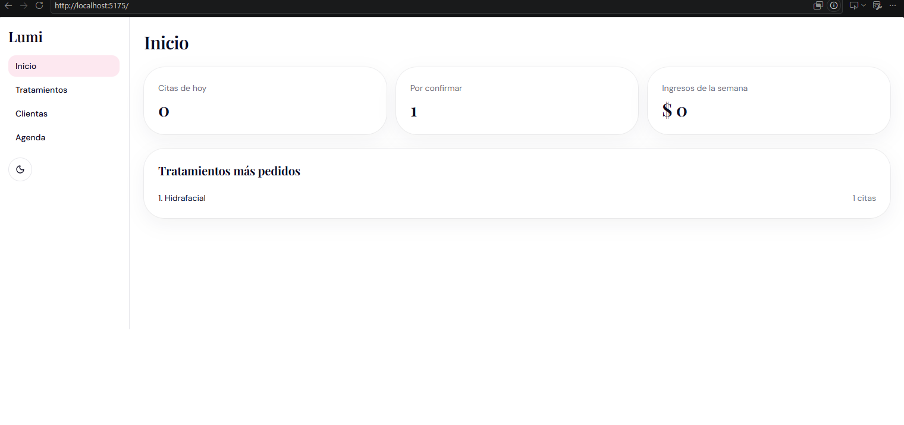
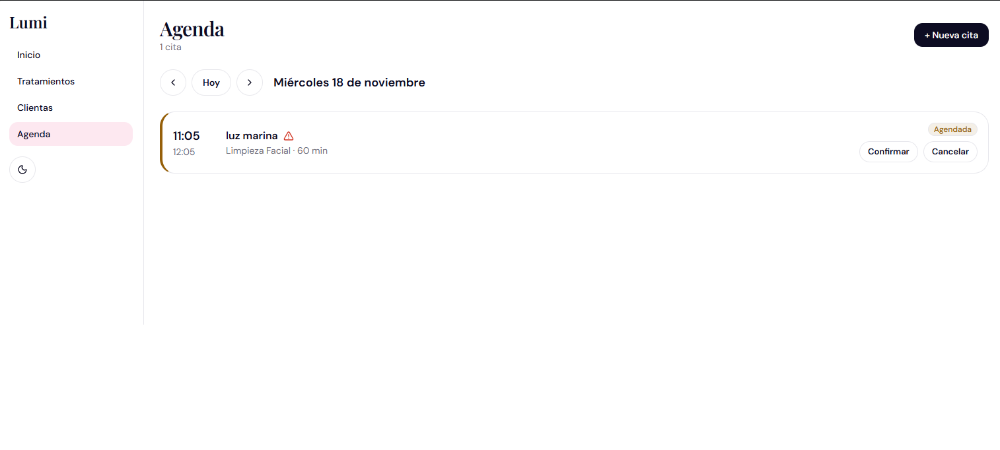
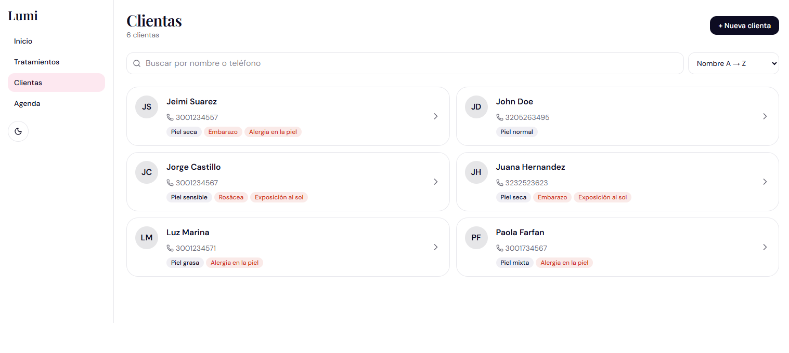
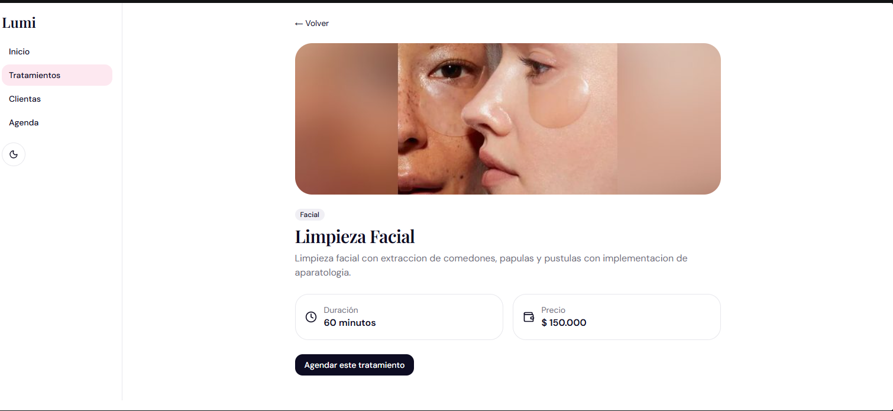

# Lumi 💆‍♀️

**Lumi** es la agenda de un centro estético: organiza el catálogo de **tratamientos**, las fichas de las **clientas** y las **citas** del día, respetando las reglas del centro.

🔗 **App en línea:** https://lumi-beauty-center.vercel.app

## Capturas

| Inicio                                                              | Agenda                                         |
| ------------------------------------------------------------------- | ---------------------------------------------- |
|  |  |

| Clientas                                            | Detalle de tratamiento                                         |
| --------------------------------------------------- | -------------------------------------------------------------- |
|  |  |

## Qué se puede hacer

- **Inicio (dashboard):** citas de hoy, citas por confirmar, ingresos de la semana y los tratamientos más pedidos.
- **Tratamientos:** catálogo con foto por categoría, detalle y registro de tratamientos nuevos.
- **Clientas:** lista con buscador (nombre o teléfono) y orden (A → Z, Z → A, tipo de piel, más alertas). Ficha con las alertas a la vista, y registrar, editar y eliminar con confirmación.
- **Agenda:** citas del día ordenadas por hora, navegación entre días, colores por estado y botones solo para los cambios de estado permitidos.
- Mensajes de éxito o error, esqueletos de carga, estados vacíos amables, modo claro y oscuro, y diseño adaptable a celular.

## Reglas del negocio

- La hora de fin de una cita se **calcula sola** con la duración del tratamiento.
- **Dos citas no se pueden cruzar**, porque el centro tiene una sola cabina (las canceladas no cuentan y las citas seguidas sí se permiten).
- **No se agenda en el pasado.**
- Una cita solo pasa a ciertos estados: agendada → confirmada o cancelada; confirmada → completada, cancelada o no asistió.
- El teléfono debe ser un celular colombiano de 10 dígitos que empiece por 3, y el correo es opcional pero válido.
- Cada clienta puede tener **alertas** (embarazo, lactancia, acné activo, rosácea, exposición reciente al sol, alergia en la piel) que la esteticista ve antes de atenderla.

## Tecnologías

React 19 · TypeScript · Vite · Tailwind CSS 4 · shadcn/ui (Base UI) · React Router · TanStack Query · react-hook-form + zod · date-fns · Sonner · Lucide · Vercel

Los datos se guardan en el navegador con `localStorage`.

## Cómo está organizado

Cada tema del negocio es una **feature** con 4 capas:

```
src/features/
  treatments/     # catálogo de tratamientos
  clients/        # fichas de clientas
  appointments/   # agenda de citas
  dashboard/      # resumen del centro
```

| Capa              | Qué tiene                                                    |
| ----------------- | ------------------------------------------------------------ |
| `domain/`         | Qué son las cosas y las reglas del negocio (funciones puras) |
| `application/`    | Las acciones que puede hacer la app (casos de uso)           |
| `infrastructure/` | De dónde vienen los datos (`localStorage`)                   |
| `ui/`             | Páginas, componentes y hooks                                 |

Las dependencias apuntan hacia `domain`, y cada feature se usa desde afuera solo por su `index.ts`. Para ordenar la lista de clientas usé el **patrón Strategy**: cada forma de ordenar es una función en un diccionario.

## Cómo correrlo

```bash
pnpm install
pnpm dev
```

| Comando       | Qué hace                               |
| ------------- | -------------------------------------- |
| `pnpm dev`    | Abre la app en `http://localhost:5173` |
| `pnpm build`  | Revisa los tipos y construye la app    |
| `pnpm lint`   | Busca problemas en el código           |
| `pnpm format` | Ordena el código con Prettier          |

## Autora

Paola · [GitHub](https://github.com/paolaarboledacas)

Proyecto hecho en mi formación con ConnectUp, con la guía de Jorge Vargas.
